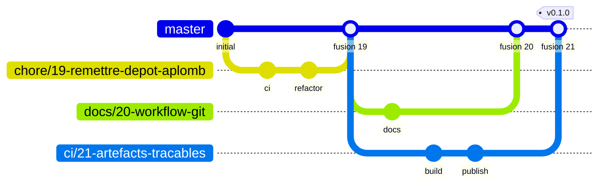

# MedHead

## Prérequis

| Outil | Version | Utilisé pour |
| --- | --- | --- |
| Docker avec le plugin Compose | Compose 2.24.4 ou plus | Démonstration, tests d'intégration, E2E et de charge, images |
| JDK | 21 (version de la CI) | Tests et JAR de l'API ; le Maven Wrapper `./mvnw` installe Maven |
| Node.js et npm | Node 24 | Tests E2E Playwright (les vérifications du front tournent aussi dans Docker) |
| Python 3 et k6 | — | Tests de charge ([guide](tests/performance/README.md)) |

La démonstration utilise les ports `5432`, `8080`, `5173` et `8180`, et les
tests d'intégration les ports `55432` et `56379`.

Le Compose de démonstration porte le nom de projet `medhead`. Sur une machine où
cette stack a déjà tourné, `docker compose up` réutilise ses volumes (données,
realm Keycloak). Pour repartir de zéro, lancer d'abord `docker compose down -v`,
qui supprime ces données, ou définir un autre `COMPOSE_PROJECT_NAME`.

## Démarrage avec Docker

Créer le fichier de configuration locale :

```bash
cp .env.example .env
```

Démarrer PostGIS, Redis, Keycloak, l'API, le consommateur d'événements de
démonstration et le front-end :

```bash
docker compose up --build
```

L'API est accessible sur <http://localhost:8080> et son état sur
<http://localhost:8080/actuator/health>. Au premier démarrage, Flyway crée le
schéma, charge les 80 spécialités du référentiel NHS, puis Docker ajoute 12
hôpitaux fictifs répartis dans le Grand Londres.

Le front-end SvelteKit est accessible sur <http://localhost:5173>.
Cliquer sur « Se connecter » et utiliser un des comptes locaux de démonstration :

| Compte | Mot de passe initial | Droits |
| --- | --- | --- |
| `lecteur` | `lecteur_demo` | Carte et référentiel en lecture seule |
| `regulateur` | `regulateur_demo` | Consultation et réservation d’un lit |

La console Keycloak est sur <http://localhost:8180> (administrateur initial
`admin` / `medhead_admin_demo`). Ces valeurs de démonstration se règlent dans
`.env` avant le premier démarrage. Utiliser `localhost` pour le navigateur ;
les URL de retour sont enregistrées avec cette origine. Le détail des sessions,
des rôles et des vérifications est dans [le guide d’authentification](docs/authentification.md).

Le front-end propose une liste de lieux de démonstration dans le Grand Londres et charge
les spécialités depuis l’API. Le bouton « Réserver un lit » envoie la demande
et affiche l’hôpital retenu, la distance et la référence de réservation.
Chaque réussite consomme un lit du jeu de démonstration.
`FRONTEND_PORT` permet de changer le port local.

Pour démarrer uniquement le front-end :

```bash
docker compose up --build frontend
```

L’API doit déjà être démarrée pour charger les spécialités et réserver un lit.
Sinon, la page affiche un message et permet de recharger les spécialités.

Le conteneur exécute l’application compilée avec l’utilisateur non privilégié
`node`, sans montage du code source : relancer `docker compose up --build`
après une modification. Pour développer avec rechargement automatique, ajouter
le fichier `docker-compose.dev.yaml` :

```bash
docker compose -f docker-compose.yaml -f docker-compose.dev.yaml up --build --watch
```

Ce mode lance le serveur de développement Vite. Il copie les modifications de
`frontend/src` et `frontend/static` dans le conteneur et reconstruit l’image
quand les dépendances changent. Le mode développement, la configuration et les
commandes de vérification sont décrits dans le
[guide du front-end](frontend/README.md).

## Hôpitaux et spécialités pour le front-end

Deux routes de lecture fournissent les données de la carte et du formulaire :
elles nécessitent désormais un JWT d’accès valide avec le rôle `LECTEUR` ou
`REGULATEUR`. Les exemples d’appels directs supposent un jeton fourni à un client
API autorisé dans la variable `MEDHEAD_ACCESS_TOKEN`. Le parcours web gère ces
jetons côté serveur ; ils ne sont pas exposés dans le navigateur.

```bash
curl -H "Authorization: Bearer $MEDHEAD_ACCESS_TOKEN" http://localhost:8080/api/v1/hospitals
curl -H "Authorization: Bearer $MEDHEAD_ACCESS_TOKEN" http://localhost:8080/api/v1/specialties
```

Les deux routes renvoient `200 OK` avec un tableau JSON trié par nom, puis par
code en cas d’égalité. Un catalogue vide renvoie `[]`.

`GET /api/v1/hospitals` fournit `id`, `code`, `name`, `latitude` et `longitude`
pour chaque hôpital, y compris ceux sans lit disponible. Les coordonnées sont
en degrés WGS84. Cette route sert à placer les hôpitaux sur la carte ; elle ne
recherche pas un hôpital et ne réserve aucun lit.

`GET /api/v1/specialties` fournit `code` et `name` pour toutes les spécialités
du référentiel, même celles sans hôpital associé. Le front-end affiche `name`
et transmet `code` lors de la réservation.

Les listes reflètent les données présentes dans la base : normalement les
12 hôpitaux de démonstration et les 80 spécialités. Les hôpitaux du jeu de charge
apparaissent aussi si ce jeu a été chargé dans la même base.

## Réservation d'un lit et outbox

L'API réserve un lit dans l'hôpital disponible le plus proche possédant la
spécialité demandée. La sélection utilise une requête PostGIS paramétrée.
Pour effectuer une réservation, le jeton doit posséder le rôle `REGULATEUR` :

```bash
curl --request POST http://localhost:8080/api/v1/hospitals/reservations \
  --header "Authorization: Bearer $MEDHEAD_ACCESS_TOKEN" \
  --header "Idempotency-Key: $(uuidgen)" \
  --header 'Content-Type: application/json' \
  --data '{
    "latitude": 51.5074,
    "longitude": -0.1278,
    "specialtyCode": "CARDIOLOGY"
  }'
```

Une réservation réussie renvoie `201 Created`, avec les informations de
l'hôpital, `reservationId`, `reservedAt` et le nombre de lits disponibles
**après** réservation, ainsi que la distance en mètres. La capacité totale
reste inchangée. Des critères invalides ou une spécialité inconnue renvoient
`400 Bad Request` ; l'absence de lit disponible renvoie `404 Not Found`.

### Idempotence des demandes

L'en-tête `Idempotency-Key` est obligatoire : le client génère un UUID par
demande de réservation et renvoie **le même UUID** s'il répète cette demande,
par exemple après un délai dépassé. Une clé absente ou qui n'est pas un UUID
renvoie `400 Bad Request` sans rien réserver.

- Une nouvelle clé crée une nouvelle réservation.
- Une clé déjà acceptée, avec les mêmes coordonnées et la même spécialité,
  renvoie la réponse d'origine (`201 Created`, même `reservationId`) avec
  l'en-tête `Idempotent-Replayed: true`. Aucun lit n'est consommé et aucun
  événement n'est ajouté.
- Une clé déjà acceptée pour une autre demande renvoie
  `422 Unprocessable Content` (`urn:problem:idempotency-key-reused`).
- Une demande refusée (spécialité inconnue, aucun lit) n'enregistre rien : elle
  peut être renvoyée avec la même clé.

La clé est rattachée à l'utilisateur authentifié (sujet `sub` du JWT) : la même
clé envoyée par un autre compte correspond à une autre demande et ne renvoie
jamais la réservation d'un tiers. Deux envois simultanés de la même clé sont
sérialisés par un verrou PostgreSQL de transaction
(`pg_advisory_xact_lock`) : le second attend la fin du premier puis renvoie sa
réservation. La clé primaire `(requested_by, idempotency_key)` de la table
`reservation_request` garantit en dernier recours qu'une clé ne crée qu'une
réservation.

Chaque ligne de `reservation_request` conserve le demandeur, la clé, une
empreinte SHA-256 de la demande (les coordonnées ne sont pas stockées en clair),
la réservation et la réponse renvoyée. Ces lignes ne sont pas purgées dans le
POC ; elles servent aussi de trace de l'auteur de chaque réservation.

### Transaction

Une seule transaction PostgreSQL effectue les quatre écritures :

1. Décrémenter `hospital.available_beds` de 1.
2. Enregistrer la réservation dans `bed_reservation` avec un UUID.
3. Enregistrer un événement `BedReserved` dans `event_outbox`.
4. Enregistrer la demande dans `reservation_request`.

La décrémentation est conditionnelle (`available_beds > 0`) et verrouille la
ligne de l'hôpital jusqu'à la fin de la transaction. Si une demande concurrente
a pris le dernier lit entre la recherche et la mise à jour, le service relance
la recherche pour réserver dans le prochain hôpital disponible. Une erreur,
y compris à l'insertion de l'outbox ou de la demande, annule toutes les écritures.

L'outbox contient un UUID d'événement, le type, l'UUID de réservation
(`aggregate_id`), la date et un payload JSON avec `eventId`, `reservationId`,
`hospitalId`, `hospitalCode`, `specialtyCode` et `occurredAt`. `published_at` reste
à `NULL` tant que l'événement attend sa publication. Pour les consulter :

```sql
SELECT id, event_type, aggregate_id, occurred_at, payload
FROM event_outbox
WHERE published_at IS NULL
ORDER BY occurred_at, id;
```

Le profil Spring `redis`, activé automatiquement dans Docker, publie les
événements en arrière-plan. Un trigger PostgreSQL émet une notification
`medhead_outbox` après le commit d'une insertion dans l'outbox. Le dispatcher
l'écoute sur une connexion dédiée et enchaîne des lots de 100 événements
jusqu'à épuisement, puis reste bloqué en attente d'une notification, sans
interrogation périodique de la table. Il s'abonne avant de lire les événements
déjà présents au démarrage ou après une reconnexion.
`MEDHEAD_OUTBOX_BATCH_SIZE` (de 1 à 1 000) règle la taille des lots.
`MEDHEAD_OUTBOX_RETRY_DELAY` (millisecondes, 1 000 par défaut) règle l'attente
avant une nouvelle tentative après une erreur. Si des événements restent en
attente après un lot incomplet, soit ils ont été validés pendant le lot et leur
notification est déjà arrivée, soit un autre publieur les verrouille et pourrait
annuler sans notifier : le dispatcher attend alors une notification, au plus
pendant ce délai. Il remplace l'ancien réglage
`MEDHEAD_OUTBOX_POLL_DELAY`.
`MEDHEAD_OUTBOX_ENABLED=false` suspend la publication tout en conservant
l'enregistrement des réservations et des événements dans PostgreSQL.

Chaque lot est publié dans une seule transaction. Le publieur verrouille
jusqu'à 100 événements avec `FOR UPDATE SKIP LOCKED`, pour que plusieurs
instances de l'API puissent publier sans sélectionner la même ligne. Il les
envoie en TLS dans un seul pipeline de `XADD`, dans l'ordre de l'outbox, et
attend la confirmation de chaque entrée. Il renseigne ensuite `published_at`
pour tout le lot avec une seule requête `UPDATE`, puis valide. Un lot coûte
donc un aller-retour Redis et un commit PostgreSQL, au lieu d'un par
événement ; avec `appendfsync always`, Redis ne synchronise en principe son
fichier AOF qu'une fois pour les commandes reçues ensemble. Les lignes
publiées sont conservées dans PostgreSQL. En cas d'échec, toute la
transaction du lot est annulée et une nouvelle tentative est différée.

La livraison suit une garantie **au moins une fois** : si Redis accepte tout
ou partie du lot mais que l'envoi échoue ensuite, ou que l'API tombe avant le
commit PostgreSQL, **tout le lot** sera renvoyé avec les mêmes `eventId`. Un
lot plus grand réduit le coût par événement mais augmente le nombre de
doublons possibles après une panne. Chaque futur consommateur devra utiliser
cet identifiant pour rendre son traitement idempotent.

Les champs du message Redis sont `eventId`, `type`, `aggregateId`, `occurredAt`
et `payload`. `payload` contient le JSON enregistré dans l'outbox et `type`
vaut `BedReserved` pour une réservation. Pour lire les derniers événements :

```bash
docker compose exec redis sh -c \
  'REDISCLI_AUTH="$REDIS_PASSWORD" redis-cli --tls --cacert /tls/ca.crt --sni redis -h redis XREVRANGE medhead:reservations + - COUNT 5'
```

La réservation et la disponibilité de l'API ne dépendent pas du succès de cet
envoi. `/actuator/health/readiness` vérifie l'API et PostgreSQL et sert au
healthcheck Docker. `/actuator/health` inclut aussi Redis et signale ses pannes.

## Configuration PostgreSQL

### Transport TLS (`verify-full`)

Toutes les connexions réseau à la base `database` sont chiffrées en TLS 1.2
ou TLS 1.3. `pg_hba.conf` (`docker/postgis/pg_hba.conf`) n'accepte que
`hostssl` avec une authentification SCRAM-SHA-256 et rejette toute connexion
TCP sans TLS. Seul le socket Unix interne au conteneur reste sans TLS : il sert
à l'initialisation, à `pg_isready` et à `docker compose exec database psql`.

Les clients utilisent `sslmode=verify-full` : ils vérifient que le certificat
du serveur est signé par l'autorité locale **et** que son nom correspond à
l'hôte contacté. Un chiffrement sans vérification (`require`) ne protège pas
contre une interception sur le réseau.

Le service ponctuel `database-tls` suit le même modèle que Redis : il génère
une autorité locale et un certificat serveur valide un an pour les noms
`database`, `localhost` et l'adresse `127.0.0.1`, et les conserve dans le
volume `postgis-tls`. La clé privée du serveur appartient à l'utilisateur
`postgres` (mode `600`) ; la clé privée de l'autorité est supprimée après
signature. Seul le certificat public de l'autorité est copié dans le volume
`postgis-ca`, monté en lecture seule dans l'API et dans les services `psql`
(`seed`, `reset-seed`, `seed-load`, `clear-load`). Aucun certificat n'est
ajouté au dépôt ou à l'image.

| Client | Configuration |
| --- | --- |
| API (Docker) | `SPRING_DATASOURCE_URL=…?sslmode=verify-full&sslrootcert=/etc/postgres-ca/ca.crt` |
| Services `psql` | `PGSSLMODE=verify-full` et `PGSSLROOTCERT=/etc/postgres-ca/ca.crt` |
| API hors Docker | URL par défaut de `application.properties`, avec `.local/postgres/ca.crt` |

Les paramètres TLS figurent dans l'URL JDBC : ils s'appliquent ainsi au pool
de connexions et à la connexion dédiée au `LISTEN` de l'outbox. Toute URL
fournie via `SPRING_DATASOURCE_URL` doit donc les conserver.

Pour lancer l'API hors Docker, copier d'abord le certificat public :

```bash
mkdir -p .local/postgres
docker compose cp database:/tls/ca.crt .local/postgres/ca.crt
```

Pour vérifier que les connexions de l'API utilisent TLS :

```bash
docker compose exec database sh -c 'psql -U "$POSTGRES_USER" -d "$POSTGRES_DB" -c "select a.application_name, s.ssl, s.version from pg_stat_ssl s join pg_stat_activity a using (pid) where a.client_addr is not null"'
```

Chaque ligne doit afficher `ssl = t`. Une connexion sans TLS est refusée avec
le message `pg_hba.conf rejects connection … no encryption` :

```bash
docker compose exec database psql "host=database user=hospital_app dbname=hospital sslmode=disable"
```

pgAdmin négocie TLS automatiquement (mode `prefer` par défaut), mais sans
vérifier le certificat. Cet outil d'administration local n'est pas exposé
hors de `127.0.0.1`.

Pour renouveler les certificats, supprimer uniquement leur volume ; les
données de `postgis-data` sont conservées :

```bash
docker compose down
docker volume rm medhead_postgis-tls
docker compose up --build
```

Une nouvelle autorité est générée et copiée dans `postgis-ca` avant le
redémarrage de l'API. Recopier `.local/postgres/ca.crt` si l'API tourne hors
Docker.

## Configuration Redis Streams

Redis `8.2.10` utilise le réseau Docker `backend`, sans port publié sur la
machine hôte. Le publieur utilise l'adresse interne `redis:6379`.

### Transport TLS et authentification

Le protocole Redis (RESP) est transporté sur TLS 1.2 ou TLS 1.3. Le port sans
TLS est désactivé (`port 0`). Le client doit vérifier le certificat du serveur
avec l'autorité locale `ca.crt`, puis s'authentifier avec `REDIS_PASSWORD`.
Les certificats clients ne sont pas requis : l'authentification utilise le
mot de passe, ce qui garde la configuration du POC simple.

Le service ponctuel `redis-tls` génère automatiquement une autorité locale et
un certificat serveur valide un an, pour les noms `redis`, `localhost` et
l'adresse `127.0.0.1`. Il conserve les certificats dans le volume `redis-tls`
et réutilise ceux déjà présents. La clé privée du serveur n'est lisible que
par l'utilisateur Redis ; la clé privée de l'autorité est supprimée après
signature. Aucun certificat ou secret généré n'est ajouté au dépôt ou à
l'image Docker. Le certificat public de l'autorité est également copié dans
le volume `redis-ca`, monté en lecture seule dans l'API. Les clés privées ne
sont pas montées dans l'API.

Le profil Spring `redis` configure Lettuce avec le bundle SSL `redis`, qui
utilise `REDIS_CA_CERT` (`file:/etc/redis-ca/ca.crt` dans Docker). La chaîne de
certification et le nom du serveur sont vérifiés. Les délais de connexion et
de réponse sont de deux secondes. Pour lancer l'API hors Docker avec Redis,
activer ce profil et fournir `REDIS_HOST`, `REDIS_PORT`, `REDIS_PASSWORD` et le
chemin du certificat public via `REDIS_CA_CERT`. Sans le profil, la publication
est désactivée et les événements restent dans PostgreSQL.

Pour vérifier la connexion TLS authentifiée :

```bash
docker compose exec redis sh -c \
  'REDISCLI_AUTH="$REDIS_PASSWORD" redis-cli --tls --cacert /tls/ca.crt --sni redis -h redis PING'
```

La réponse attendue est `PONG`. Le mot de passe de démonstration se règle dans
`.env` via `REDIS_PASSWORD`.

### Persistance et mémoire

Le volume `redis-data` conserve les données sous `/data`, y compris les streams
et l'état des groupes de consommateurs. AOF est activé avec
`appendfsync always` : les écritures sont synchronisées sur disque avant la
réponse. Ce choix privilégie la durabilité au débit, adapté au POC. Il évite la
fenêtre de perte d'environ une seconde de `appendfsync everysec`, qui pourrait
faire disparaître un événement déjà marqué comme publié dans l'outbox.

Des snapshots RDB sont également effectués toutes les cinq minutes si les
données ont changé. `REDIS_MAXMEMORY` fixe la limite mémoire (256 Mio par
défaut), avec `maxmemory-policy noeviction` : Redis refuse les nouvelles
écritures quand la limite est atteinte au lieu de supprimer le stream.
Le publieur laisse l'événement dans l'outbox lorsqu'un envoi échoue.
Un volume conserve les données lors d'un redémarrage ou d'un `docker compose
down`, mais ne constitue pas une sauvegarde contre la perte du disque hôte.

### Rétention du stream et MAXLEN

`REDIS_STREAM_KEY` fixe le nom `medhead:reservations` et
`REDIS_STREAM_MAXLEN` fixe une cible de 10 000 événements. Ces valeurs sont
transmises à l'API via `medhead.events.stream.key` et
`medhead.events.stream.max-length`.

`MAXLEN` n'est pas une option globale de `redis.conf` : le publieur la passe
à chaque écriture :

```text
XADD medhead:reservations ACKED MAXLEN ~ 10000 * eventId UUID type BedReserved payload JSON
```

Le `~` applique une limite approximative, plus efficace qu'une suppression à
chaque ajout. `ACKED` (disponible depuis Redis 8.2) protège les événements qui
n'ont pas été acquittés par tous les groupes de consommateurs existants. Si
un groupe prend du retard, la longueur peut dépasser la cible. Sans groupe,
`ACKED` ne protège rien. Le publieur crée donc tous les groupes configurés
(`XGROUP CREATE … MKSTREAM`) avant son premier envoi, et ignore uniquement
l'erreur indiquant qu'un groupe existe déjà. Il ne les revérifie pas à chaque
événement : les groupes vivent avec le stream, et le publieur envoie ses `XADD`
avec `NOMKSTREAM`. Si le stream a été supprimé, Redis refuse l'ajout au lieu de
recréer un stream sans groupe ; le publieur recrée alors le stream et ses groupes,
puis renvoie l'événement. Seule la suppression explicite d'un groupe
(`XGROUP DESTROY`) sur un stream existant n'est pas détectée avant le
redémarrage de l'API.
La limite représente un nombre d'entrées, pas une taille mémoire
ou une durée. La persistance AOF ne restaure pas les entrées supprimées par
la rétention.

`REDIS_STREAM_CONSUMER_GROUPS` configure la liste des groupes, séparés par des
virgules (par défaut `reservation-consumers`). Ils commencent à l'offset `0-0`
pour inclure les événements déjà présents dans le stream. Prévoir un groupe
par service qui doit recevoir tous les événements ; les instances d'un même
service partagent leur groupe. Aucun consommateur métier n'est encore construit :
le consommateur de démonstration ci-dessous acquitte les événements du groupe
`reservation-consumers`. Si un groupe ne suit plus (consommateur arrêté), ses
événements restent non acquittés et la cible MAXLEN peut être dépassée, jusqu'à
la limite mémoire de Redis.

### Consommateur de démonstration

Le service `event-consumer` ([`docker/event-consumer/consumer.py`](docker/event-consumer/consumer.py))
remplace un futur consommateur métier (hôpital receveur, tableau de bord). Ce
script Python lit le stream dans le groupe `reservation-consumers` avec
`XREADGROUP`, journalise chaque événement (`eventId`, `type`, `aggregateId`,
`occurredAt`) puis l'acquitte (`XACK`). La rétention `ACKED` peut ainsi réduire
le stream à sa cible.

- Il se connecte en TLS vérifié avec le même mot de passe que l'API.
- Il acquitte après la journalisation : un arrêt entre les deux redélivre
  l'événement au redémarrage (au moins une fois), comme pour un vrai consommateur.
- Au démarrage, il traite d'abord les événements reçus mais non acquittés avant
  un arrêt, puis les nouveaux.
- Si le stream est supprimé (remise à zéro entre deux campagnes de charge), il
  recrée son groupe et reprend.

| Variable | Défaut | Rôle |
| --- | --- | --- |
| `EVENT_CONSUMER_GROUP` | `reservation-consumers` | Groupe lu et acquitté |
| `EVENT_CONSUMER_LOG_EVENTS` | `true` | `false` : un résumé toutes les 10 s au lieu d'une ligne par événement |

Suivre les événements reçus et le retard du groupe :

```bash
docker compose logs -f event-consumer
docker compose exec redis sh -c 'REDISCLI_AUTH="$REDIS_PASSWORD" redis-cli --tls --cacert /tls/ca.crt --sni redis -h redis XINFO GROUPS medhead:reservations'
```

`lag` (entrées non encore lues) et `pending` (lues mais non acquittées) restent
proches de zéro quand le consommateur suit.

### Renouvellement des certificats locaux

Lorsqu'un certificat expire, arrêter les services puis supprimer uniquement
le volume de certificats avant de redémarrer :

```bash
docker compose down
docker volume rm medhead_redis-tls
docker compose up --build
```

Le volume `redis-data` et la base PostgreSQL restent conservés. Une nouvelle
autorité est générée et son certificat public est copié dans `redis-ca` avant
le redémarrage de l'API, qui charge ainsi la nouvelle autorité.
La commande globale `docker compose down -v` supprime aussi toutes les données.

## Tests

Les tests sans base de données se lancent avec :

```bash
./mvnw test
```

Ils incluent une règle d'architecture vérifiée par ArchUnit
(`ArchitectureTest`). Dans le module `hospital`, les dépendances vont dans un
seul sens : `api` → `application` → `persistence` → `domain`. La couche
`application` reçoit une commande (`ReserveBedCommand`) et renvoie ses propres
résultats (`ReservedBed`, `HospitalSummary`, `SpecialtySummary`). Les DTO HTTP
et leur conversion restent dans `api`. Une dépendance dans l'autre sens fait
échouer le build.

Les tests PostgreSQL utilisent une base PostGIS dédiée, éphémère, sur le port
`55432`. Ils vérifient la transaction, le rollback en cas d'échec de l'outbox,
la réservation concurrente du dernier lit et la sélection de l'hôpital suivant.
Ils vérifient aussi l'idempotence : rejeu d'une même clé sans second lit, refus
d'une clé réutilisée pour une autre demande, clé propre à chaque utilisateur,
nouvel essai possible après un refus et envois simultanés d'une même clé.
Ils couvrent aussi les catalogues d’hôpitaux et de spécialités : coordonnées,
tri, listes vides et absence de réservation lors de la lecture.

La base de test impose TLS comme la base de démonstration : copier son
certificat public avant les tests. `DatabaseTlsIntegrationTest` vérifie que le
pool de l'application utilise TLS, que le serveur refuse une connexion sans TLS
et que `verify-full` refuse un certificat signé par une autre autorité.

```bash
docker compose -f docker-compose.test.yaml up --build -d --wait database
mkdir -p .local/postgres-tests
docker compose -f docker-compose.test.yaml cp database:/tls/ca.crt .local/postgres-tests/ca.crt
./mvnw -Dmedhead.integration-tests=true test
docker compose -f docker-compose.test.yaml down -v
```

Pour lancer également les tests Redis TLS, le Compose de test expose Redis
uniquement sur `127.0.0.1:56379`. Copier les deux certificats publics avant
les tests :

```bash
docker compose -f docker-compose.test.yaml up --build -d --wait
mkdir -p .local/postgres-tests .local/redis-tests
docker compose -f docker-compose.test.yaml cp database:/tls/ca.crt .local/postgres-tests/ca.crt
docker compose -f docker-compose.test.yaml cp redis:/tls/ca.crt .local/redis-tests/ca.crt
./mvnw -Dmedhead.integration-tests=true -Dmedhead.redis-integration-tests=true test
docker compose -f docker-compose.test.yaml down -v
```

Ces tests couvrent la publication TLS, le refus d'un certificat non fiable,
la reprise après erreur d'authentification, le rollback, l'exclusion des
transactions non validées, les publications concurrentes et la rétention
`ACKED`. Ils vérifient aussi que les groupes ne sont créés qu'une fois, puis
recréés avec le stream si celui-ci est supprimé. Ils vérifient aussi qu'un échec Redis ou un échec du commit PostgreSQL
laisse tout le lot en attente, que la reprise renvoie le lot avec les mêmes
`eventId`, et que l'ordre de l'outbox est conservé dans le stream.

Pour utiliser d'autres ports, définir `TEST_POSTGRES_PORT` et `TEST_REDIS_PORT`
lors du démarrage Docker, puis passer les valeurs correspondantes via
`'-Dmedhead.test.jdbc-url=jdbc:postgresql://localhost:PORT/hospital_test?sslmode=verify-full&sslrootcert=.local/postgres-tests/ca.crt'`
(les guillemets protègent le `&` du shell) et
`-Dmedhead.test.redis-port=PORT`. `-Dmedhead.test.redis-ca=file:/chemin/ca.crt`
permet d'utiliser un autre emplacement de certificat public.

### Tests d'acceptation (Cucumber)

Le scénario du document d'exigences est exécuté tel quel par Cucumber, en
français, dans
[`intervention-urgence.feature`](src/test/resources/features/intervention-urgence.feature).
Le fichier contient trois scénarios :

1. le scénario du document d'exigences, recopié mot pour mot avec la table des
   hôpitaux Fred Brooks, Julia Crusher et Beverly Bashir : une urgence en
   cardiologie près de Fred Brooks y réserve un lit, et l'événement
   `BedReserved` est écrit dans l'outbox ;
2. une urgence tout près de Julia Crusher, compétente mais complète : Fred
   Brooks est proposé, ce qui prouve le filtre sur les lits disponibles ;
3. une spécialité qu'aucun de ces hôpitaux ne propose : la demande est refusée
   (`404`), sans lit consommé ni événement.

Les étapes (`com.example.medhead.acceptance`) démarrent l'application complète
sur la même base PostGIS TLS de test que les autres tests d'intégration. Elles
appellent l'API REST avec MockMvc, un jeton de rôle `REGULATEUR` et un en-tête
`Idempotency-Key`. Chaque scénario crée ses propres hôpitaux (codes `PDF-…`)
et les supprime ensuite : il ne dépend pas du jeu de démonstration.

La suite `EmergencyInterventionAcceptanceTest` fait partie de `./mvnw verify`
dès que `-Dmedhead.integration-tests=true` est passé (profil Maven
`integration-tests`) ; sans cette propriété, Surefire ne la lance pas. Le
rapport HTML est écrit dans `target/cucumber-report.html`. Pour la lancer
seule, une fois la base de test démarrée et son certificat copié :

```bash
./mvnw -Dmedhead.integration-tests=true -Dtest=EmergencyInterventionAcceptanceTest test
```

### Tests de bout en bout (E2E)

Les tests [Playwright](https://playwright.dev/) de `frontend/e2e/` pilotent
Chromium sur la stack de démonstration complète : front-end, API, Keycloak,
PostGIS et Redis. Ils vérifient cinq parcours :

| Parcours | Résultat attendu |
| --- | --- |
| Régulateur, Secteur Westminster, Cardiologie | L'hôpital retenu, la distance et la référence de réservation s'affichent |
| Régulateur, Secteur Westminster, Allergie | Le message d'absence de lit s'affiche, sans réservation |
| Lecteur | Message de lecture seule, formulaire désactivé ; l'action envoyée directement au serveur est refusée (`403`) |
| Visiteur non connecté | Seul « Se connecter » est proposé ; le lien mène à la page de connexion Keycloak |
| Déconnexion | La session MedHead est fermée, et la session Keycloak aussi : une reconnexion redemande les identifiants |

Prérequis : Docker avec le plugin Compose, Node 24 et npm. Les tests utilisent
les ports fixes de la démonstration (`5432`, `8080`, `5173`, `8180`), imposés
par les URL de retour enregistrées dans Keycloak : arrêter toute autre stack de
démonstration avant de commencer. Partir d'une stack fraîche, car Keycloak
n'importe le realm qu'au premier démarrage.

```bash
export COMPOSE_PROJECT_NAME=medhead-e2e
cp .env.example .env
docker compose up --build -d --wait --wait-timeout 300 api frontend
cd frontend
npm ci
npx playwright install chromium
npm run test:e2e
```

La commande `up` n'attend que les services `api` et `frontend` (et leurs
dépendances). Sans liste de services, `--wait` renvoie le code `1` alors que la
stack est saine : le service ponctuel `seed` se termine après le chargement des
données, et Compose compte cet arrêt comme un échec. Les données sont chargées
par les tests eux-mêmes : avant la suite, le `globalSetup` de Playwright lance
`docker compose --profile maintenance run --rm --no-deps reset-seed`, qui
recrée les 12 hôpitaux de démonstration avec leurs lits initiaux. Chaque
exécution part donc des mêmes données, même si `seed` n'a pas tourné.

Le rapport HTML est écrit dans `frontend/playwright-report/` et s'ouvre avec
`npx playwright show-report`. Les captures des tests en échec sont dans
`frontend/test-results/`. En CI, un test en échec est relancé une fois avec
une trace Playwright.

Variables utiles :

| Variable | Défaut | Rôle |
| --- | --- | --- |
| `E2E_BASE_URL` | `http://localhost:5173` | Origine du front-end testé. Elle doit être égale à `MEDHEAD_PUBLIC_ORIGIN` : utiliser `localhost`, pas `127.0.0.1` |
| `E2E_RESET_SEED` | (activé) | `false` conserve les données en place au lieu de lancer `reset-seed` |
| `KEYCLOAK_URL` | `http://localhost:8180` | Origine de Keycloak, comme dans `.env` |
| `KEYCLOAK_REGULATEUR_PASSWORD`, `KEYCLOAK_LECTEUR_PASSWORD` | Valeurs de `.env.example` | Mots de passe des comptes de démonstration |

Terminer par :

```bash
cd ..
docker compose down -v
unset COMPOSE_PROJECT_NAME
```

`npm test` ne lance pas ces tests : il se limite aux tests unitaires de
`frontend/tests/`.

### Tests du front-end

Les tests unitaires (`node:test`) et la vérification des types tournent dans
l'image de développement du front, sans Node sur la machine hôte (détails dans
le [guide du front-end](frontend/README.md#vérifications)) :

```bash
docker compose -f docker-compose.yaml -f docker-compose.dev.yaml run --build --rm --no-deps frontend npm test
docker compose -f docker-compose.yaml -f docker-compose.dev.yaml run --build --rm --no-deps frontend npm run check
```

### Construire les artefacts

| Artefact | Commande | Résultat |
| --- | --- | --- |
| JAR de l'API | `./mvnw -DskipTests clean package` | `target/medhead-0.1.0-SNAPSHOT.jar` |
| JAR testé, comme en CI | `clean verify` avec les tests d'intégration (voir [Reproduire les étapes principales en local](#reproduire-les-étapes-principales-en-local)) | Même JAR, après les tests unitaires, d'intégration et d'acceptation |
| Image de l'API | `docker build --tag medhead:ci .` | Image locale `medhead:ci` |
| Image du front-end | `docker compose build frontend` | Image locale `medhead-frontend:runtime` |

Le Dockerfile de l'API recompile le code : l'image ne dépend pas d'un JAR
construit au préalable. Les artefacts versionnés (images GHCR et JAR des
releases) sont produits par la CI, décrite ci-dessous.

## Intégration continue

Le workflow GitHub Actions [Backend CI](.github/workflows/ci.yml) exécute trois
jobs, `frontend-ci`, `backend-ci` et `e2e`, pour les pull requests ciblant
`master`, les push sur `master` et les tags `v*`. Il peut aussi être lancé
manuellement depuis l'onglet **Actions**, une fois le workflow présent sur la
branche par défaut. Deux jobs de livraison s'y ajoutent, jamais sur une pull
request : `publish` publie les images sur GHCR et `release` crée une GitHub
Release (voir [Versionnage et livraison](#versionnage-et-livraison)).

Le job `frontend-ci` utilise Node 24 : il installe les dépendances avec `npm ci`,
lance les tests, la vérification Svelte et la compilation, puis construit les
deux images Docker du front-end (cibles `runtime` et `dev`).

Le job `backend-ci` utilise Ubuntu 24.04, Java 21 Temurin et le Maven Wrapper du dépôt,
avec un cache des dépendances Maven. Il est limité à 20 minutes et dispose
uniquement de la permission `contents: read`. Les services utilisent les
identifiants de test du Compose ; aucun secret GitHub ou fichier `.env`
personnel n'est nécessaire.

Les étapes s'exécutent dans cet ordre :

1. Récupérer le code et préparer Java et le cache Maven.
2. Construire et démarrer PostGIS TLS et Redis TLS avec
   `docker-compose.test.yaml`, puis attendre leur disponibilité. L'attente
   après démarrage est limitée à 120 secondes.
3. Copier les certificats publics de PostgreSQL et de Redis dans
   `.local/postgres-tests/ca.crt` et `.local/redis-tests/ca.crt`.
4. Exécuter `clean verify` avec les deux propriétés d'intégration activées :
   les tests unitaires et d'intégration sont exécutés, puis le JAR est créé.
5. Vérifier les rapports JUnit de `DatabaseTlsIntegrationTest`,
   `HospitalCatalogIntegrationTest`, `BedReservationIntegrationTest`,
   `OutboxPublicationIntegrationTest` et de la suite d'acceptation Cucumber
   `EmergencyInterventionAcceptanceTest`.
   Le job échoue si un rapport manque,
   si une suite n'a exécuté aucun test ou si elle contient des tests ignorés,
   des échecs ou des erreurs.
6. Construire l'image `medhead:ci` avec le Dockerfile du dépôt. Sa construction
   intervient seulement après la réussite des tests et du contrôle des rapports.

Chaque exécution utilise un nom de projet Compose contenant l'identifiant
de l'exécution et son numéro de tentative, pour isoler ses conteneurs et
volumes. Le nettoyage s'exécute avec `always()` après les étapes de
diagnostic, y compris lorsqu'une étape échoue : il arrête les services et
supprime uniquement les volumes de cet environnement de test.

Les artefacts suivants sont téléchargeables depuis la page de l'exécution
GitHub Actions pendant sept jours :

| Artefact | Contenu | Disponibilité |
| --- | --- | --- |
| `backend-test-reports-<sha>` | Rapports XML et texte de `target/surefire-reports/` | Même après un échec, si Maven a produit des rapports |
| `cucumber-acceptance-report-<sha>` | Rapport HTML des scénarios d'acceptation (`target/cucumber-report.html`) | Même après un échec, si Cucumber a produit le rapport |
| `backend-jar-<sha>` | JAR de l'application, avec sa version et son commit | Après un `clean verify` réussi, même si la construction Docker échoue ensuite |
| `backend-docker-diagnostics` | État des conteneurs et logs Compose | En cas d'échec du job avant le nettoyage |

`<sha>` est le SHA complet du commit testé (`github.sha`) : pour une pull
request, c'est le commit de fusion temporaire calculé par GitHub. Le nom de la
branche n'est pas utilisé, car un nom d'artefact ne peut pas contenir de `/`.

Le Dockerfile recompile actuellement l'application avec `-DskipTests`.
Cette seconde compilation suit la validation complète réalisée par Maven
dans le job. Les images `medhead:ci` et `medhead-frontend:ci` restent locales
au runner ; le job `publish` construit et publie les images livrées. Le
déploiement et les tests de charge feront l'objet de workflows distincts.

### Versionnage et livraison

| Contexte | Version du JAR | Tags des images GHCR |
| --- | --- | --- |
| Travail en cours (branche, pull request) | `0.1.0-SNAPSHOT` (`pom.xml`) | Aucun : rien n'est publié |
| Push sur `master` | `0.1.0-SNAPSHOT` (`pom.xml`) | `sha-<7 caractères>` et `master` |
| Tag `vX.Y.Z` | `X.Y.Z` pour le JAR de la release et l'image (l'artefact `backend-jar-<sha>` reste en SNAPSHOT) | `X.Y.Z` et `latest` |

Après la réussite de `frontend-ci`, `backend-ci` et `e2e`, le job `publish`
construit et publie deux images :

| Image | Dockerfile |
| --- | --- |
| `ghcr.io/thefatandfurious/medhead-api` | `Dockerfile` |
| `ghcr.io/thefatandfurious/medhead-frontend` | `frontend/Dockerfile`, cible `runtime` |

Seul ce job dispose de la permission `packages: write` ; il se connecte à GHCR
avec le `GITHUB_TOKEN` de l'exécution, sans autre secret. Sur un tag, le job
`release` construit ensuite le JAR en version `X.Y.Z` et crée la GitHub Release
correspondante, avec le JAR et des notes générées depuis les pull requests.
Seul ce job dispose de la permission `contents: write`.

#### Retrouver le commit d'un artefact

Chaque JAR construit depuis un clone Git contient `git.properties` (commit,
branche) et `META-INF/build-info.properties` (version). L'API les expose sans
authentification, en lecture seule, sur `/actuator/info`. Pour un JAR lancé
hors Docker (`java -jar target/medhead-0.1.0-SNAPSHOT.jar`) :

```bash
curl -s http://localhost:8080/actuator/info
```

```json
{"git":{"branch":"master","commit":{"id":"b31cfc3","time":"2026-11-22T10:38:11Z"}},
 "build":{"artifact":"medhead","name":"MedHead","time":"…","version":"0.1.0-SNAPSHOT","group":"com.example"}}
```

Dans la stack Docker, la même commande renvoie `"git":{}` et seulement la
partie `build` (voir ci-dessous) : le commit d'une image se lit dans ses labels.

Les images portent les labels OCI `org.opencontainers.image.revision` (SHA
complet), `.version`, `.created` et `.source`. Elles sont publiées pour
`linux/amd64` uniquement : sur un Mac à processeur Apple, préciser la
plateforme au téléchargement, sinon Docker répond `no matching manifest for
linux/arm64/v8`.

```bash
docker pull --platform linux/amd64 ghcr.io/thefatandfurious/medhead-api:master
docker inspect --format '{{ index .Config.Labels "org.opencontainers.image.revision" }}' \
  ghcr.io/thefatandfurious/medhead-api:master
```

Le contexte Docker exclut `.git` : le JAR d'une image ne contient donc que la
version, et le commit d'une image se lit avec `docker inspect`. Pour une
construction locale, ces informations se passent en arguments (`VCS_REF`,
`VERSION`, `BUILD_DATE`) ; à défaut, les labels valent `unknown`. Dans un
worktree Git, le plugin lit le commit du dépôt principal : construire depuis un
clone classique pour obtenir le commit exact.

#### Publier une release

Une fois `master` à jour et sa CI verte, poser un tag de version et le pousser :

```bash
git tag v0.1.0 && git push origin v0.1.0
```

Le workflow teste le commit taggé, publie les images `0.1.0` et `latest`, puis
crée la release `v0.1.0` avec `medhead-0.1.0.jar`. La version du `pom.xml`
reste en `-SNAPSHOT` ; la passer à la version suivante (par exemple
`0.2.0-SNAPSHOT`) dans une pull request ultérieure.

### Job `e2e`

Le job `e2e` démarre après la réussite de `frontend-ci` et de `backend-ci`. Il
est limité à 25 minutes et utilise un nom de projet Compose propre à
l'exécution. Il copie `.env.example` dans `.env`, construit et démarre la stack
de démonstration avec `docker compose up --build -d --wait --wait-timeout 300
api frontend`, installe les dépendances et Chromium, puis lance
`npm run test:e2e` (voir « Tests de bout en bout » ci-dessus). Le nettoyage
`docker compose down --volumes --remove-orphans` s'exécute toujours.

| Artefact | Contenu | Disponibilité |
| --- | --- | --- |
| `playwright-report-<sha>` | Rapport HTML Playwright, avec les traces des tests relancés | Toujours, si le rapport existe |
| `e2e-docker-diagnostics` | État des conteneurs et logs Compose | En cas d'échec du job |

### Reproduire les étapes principales en local

Prérequis : Java 21 et Docker avec le plugin Compose. Les ports `55432` et
`56379` doivent être libres. Utiliser un nom de projet distinct pour éviter
de toucher aux services de démonstration ou à un autre environnement de test :

```bash
export COMPOSE_PROJECT_NAME=medhead-ci-local
docker compose -f docker-compose.test.yaml up --build -d --wait --wait-timeout 120
mkdir -p .local/ci-local
docker compose -f docker-compose.test.yaml cp database:/tls/ca.crt .local/ci-local/postgres-ca.crt
docker compose -f docker-compose.test.yaml cp redis:/tls/ca.crt .local/ci-local/ca.crt
./mvnw --batch-mode --no-transfer-progress \
  -Dmedhead.integration-tests=true \
  -Dmedhead.redis-integration-tests=true \
  '-Dmedhead.test.jdbc-url=jdbc:postgresql://localhost:55432/hospital_test?sslmode=verify-full&sslrootcert=.local/ci-local/postgres-ca.crt' \
  -Dmedhead.test.redis-ca=file:./.local/ci-local/ca.crt \
  clean verify
```

Si Maven réussit, construire l'image avec `docker build --tag medhead:ci .`.
En cas d'échec, consulter les rapports dans `target/surefire-reports/` et
les logs avec `docker compose -f docker-compose.test.yaml logs --no-color`.
Terminer dans les deux cas par :

```bash
docker compose -f docker-compose.test.yaml down --volumes --remove-orphans
unset COMPOSE_PROJECT_NAME
```

### Validation avant fusion

Sur une première pull request, vérifier une exécution réussie puis provoquer
temporairement un échec de test. Le job doit devenir rouge, rendre les rapports
et diagnostics disponibles et exécuter le nettoyage. Retirer ensuite cette
modification et obtenir une nouvelle exécution réussie. Une fois le contrôle
visible sur GitHub, ajouter `backend-ci` aux contrôles obligatoires de la règle
de protection de `master` pour conditionner la fusion à sa réussite.

## Workflow Git

Le dépôt suit **GitHub Flow** : toute modification part d'une issue, se fait
sur une branche courte et rejoint `master` par une pull request validée par la
CI et relue. Cette section décrit le circuit complet, pour qu'une nouvelle
personne puisse l'appliquer sans aide.

### Modèle retenu : GitHub Flow

- `master` est **toujours livrable** : chaque commit qui y arrive a passé la CI
  et une relecture.
- Le travail se fait sur des **branches courtes**, créées depuis un `master` à
  jour et fusionnées dès qu'elles sont prêtes, en quelques jours au plus.
- Les versions sont des **tags** posés sur `master`, pas des branches.

**Pourquoi pas GitFlow ?** GitFlow ajoute des branches longues (`develop`,
`release/*`, `hotfix/*`). Il est utile quand plusieurs versions sont maintenues
en parallèle avec des livraisons planifiées. MedHead est une preuve de concept,
portée par une petite équipe, avec une seule version en service et une
intégration et une livraison continues. Des branches longues retarderaient
l'intégration : les conflits s'accumuleraient et la CI ne validerait
l'ensemble qu'au moment de la release. Avec GitHub Flow, chaque changement est
intégré et testé avec le reste du code dès qu'il est prêt.

### Cycle d'une modification

1. **Issue** : décrire le besoin avec le modèle « Tâche » (contexte, tâches,
   définition de terminé, critères couverts). Avant de commencer, vérifier
   que l'issue n'a pas le label `en-cours`, puis l'ajouter.
2. **Branche créée depuis l'issue**, à partir d'un `master` à jour :

   ```bash
   git switch master
   git pull
   gh issue develop 20 --base master --name docs/20-workflow-git --checkout
   ```

   `gh issue develop` lie la branche à l'issue : elle apparaît dans la rubrique
   **Development** de l'issue. Pour travailler sur plusieurs branches en même
   temps, utiliser un worktree dédié plutôt que de changer de branche :
   `git worktree add ../medhead-20 docs/20-workflow-git`.
3. **Commits** petits et thématiques, au format Conventional Commits, avec
   `Refs #N` en pied (voir plus bas).
4. **Pull request** vers `master` :

   ```bash
   git push -u origin docs/20-workflow-git
   gh pr create --base master
   ```

   Le [modèle de PR](.github/pull_request_template.md) est prérempli : la
   description doit contenir `Closes #N` pour fermer l'issue à la fusion.
5. **CI verte et relecture** : les jobs `frontend-ci`, `backend-ci` et `e2e`
   doivent réussir. Les corrections demandées en relecture sont ajoutées par de
   nouveaux commits sur la même branche.
6. **Fusion en merge commit** par le relecteur, depuis GitHub ou avec
   `gh pr merge --merge --delete-branch`. L'issue se ferme automatiquement.
7. **Suppression de la branche** : la branche distante est supprimée à la
   fusion ; en local, `git switch master && git pull && git branch -d <branche>`
   (et `git worktree remove <dossier>` si un worktree a été utilisé).

### Nommage des branches

Format : `<type>/<n° issue>-<sujet-court>`, en minuscules, sans accents, avec
des tirets. Le numéro relie la branche à son issue ; le type annonce la nature
du changement et reprend les types de commit ci-dessous (`feat`, `fix`, `test`,
`ci`, `docs`, `chore`, `refactor`).

Exemples réels du dépôt :

| Branche | Issue | Contenu |
| --- | --- | --- |
| `chore/19-remettre-depot-aplomb` | #19 | Remise d'aplomb du dépôt (PR #28) |
| `docs/20-workflow-git` | #20 | Cette section et les modèles GitHub |
| `ci/21-artefacts-tracables` | #21 | Artefacts versionnés et traçables |
| `test/23-e2e-playwright` | #23 | Tests de bout en bout Playwright |

### Messages de commit : Conventional Commits

Les commits suivent [Conventional Commits](https://www.conventionalcommits.org/fr/) :

```text
<type>(<portée facultative>): <résumé à l'impératif, 72 caractères au plus>

<corps : pourquoi ce changement, ce qu'il corrige ou rend possible>

Refs #19
```

| Type | Usage |
| --- | --- |
| `feat` | Nouvelle fonctionnalité |
| `fix` | Correction de bug |
| `docs` | Documentation seule |
| `test` | Ajout ou correction de tests |
| `refactor` | Restructuration sans changement de comportement |
| `ci` | Workflows GitHub Actions |
| `build` | Outillage de construction (Maven, Dockerfile) |
| `chore` | Entretien du dépôt (`.gitignore`, fichiers obsolètes) |

Exemples réels, pris dans l'historique de `master` :

```text
feat(db): enforce TLS verify-full between the API and PostgreSQL
ci: add GitHub Actions workflow for the front-end and the back-end
refactor: align the source folder name with the package name
chore: stop tracking Python bytecode
build: add maven wrapper configuration
```

Règles :

- **Un sujet par commit** : jamais de commit « fourre-tout ».
- Le **corps** explique le *pourquoi* ; le *quoi* se lit dans le diff.
- Le **pied** référence l'issue : `Refs #N` sur chaque commit de la branche,
  `Closes #N` dans la description de la PR. Un commit qui règle à lui seul une
  autre issue peut la fermer directement (`Closes #11` dans `471095c`).
- Un changement incompatible est signalé par `!` après le type
  (`feat!: ...`) ou par un pied `BREAKING CHANGE:` ; il impose une nouvelle
  version majeure.
- Les messages sont rédigés en anglais, comme le code. La convention
  s'applique depuis le lot #19 ; les premiers commits du dépôt la précèdent.

### Protection de `master`

La règle de protection de `master` (**Settings → Branches** du dépôt GitHub)
impose :

- **pull request obligatoire** : aucun push direct sur `master`, y compris
  pour les administrateurs ;
- **contrôles requis** : `frontend-ci`, `backend-ci` et `e2e` ; une PR dont un
  contrôle est rouge ou en cours ne peut pas être fusionnée ;
- **historique protégé** : ni suppression de `master`, ni réécriture
  (`push --force`) ;
- la fusion est faite par le relecteur, après relecture de la PR.

### Stratégie de fusion : merge commit

Les PR sont fusionnées en **merge commit** (ni squash, ni rebase) :

- les commits atomiques de la branche sont conservés tels quels, avec leur
  message et leur référence à l'issue ;
- le commit de fusion porte le numéro de la PR et le nom de la branche, par
  exemple `Merge pull request #28 from TheFatAndFurious/chore/19-remettre-depot-aplomb` ;
- on remonte ainsi d'une ligne de code à son commit, à sa PR, puis à son
  issue (issue ↔ branche ↔ PR ↔ commits) ;
- `git log --first-parent --oneline master` affiche une ligne par PR fusionnée,
  `git log --graph --oneline` montre les branches ;
- un lot complet peut être annulé d'un coup avec `git revert -m 1 <commit de fusion>`.

Un squash réduirait la branche à un seul commit et perdrait le détail ; un
rebase effacerait la frontière de la branche et le lien visible avec la PR.

### Versions et tags

Les versions suivent [SemVer](https://semver.org/lang/fr/) : `vMAJEUR.MINEUR.CORRECTIF`.
Le correctif augmente pour une correction compatible, le mineur pour une
fonctionnalité compatible, le majeur pour un changement incompatible. Tant
que le projet reste une preuve de concept, les versions sont en `0.y.z`.

Un tag annoté est posé **sur `master` uniquement**, après la fusion des PR
concernées :

```bash
git switch master
git pull
git tag -a v0.1.0 -m "v0.1.0"
git push origin v0.1.0
```

Le push d'un tag `v*` déclenche la publication des artefacts versionnés
(images Docker et release GitHub), décrite dans la section
[Intégration continue](#intégration-continue) ; ces jobs ont été ajoutés par
[#21](https://github.com/TheFatAndFurious/MedHead/issues/21). Un tag publié
n'est jamais déplacé : une erreur se corrige par une nouvelle version.

### Correctifs

Un correctif suit **le même circuit** que le reste : issue, branche
`fix/<n° issue>-<sujet>` créée depuis `master`, PR, CI verte, relecture et
merge commit. Il n'y a pas de branche `hotfix` séparée : `master` est toujours
livrable et une seule version est en service. Si le correctif doit être livré,
on pose ensuite un tag de version corrective (par exemple `v0.1.1`).

### Vue d'ensemble

Le diagramme illustre le circuit avec les branches des premiers lots ; le tag
est un exemple.



### Pourquoi des commits atomiques, des branches et des merges

- **Revue facilitée** : une PR courte, découpée en commits qui traitent chacun
  un sujet, se relit commit par commit.
- **Retour arrière ciblé** : un commit atomique s'annule avec `git revert`
  sans emporter le reste ; un merge commit permet d'annuler un lot entier.
- **CI isolée par changement** : chaque branche est testée seule avant
  d'atteindre `master`, donc un échec désigne directement le changement fautif
  et `master` reste livrable.
- **Historique qui documente le *pourquoi*** : le corps des commits, la PR et
  l'issue liée expliquent les décisions, et `git blame` ou `git log` y mènent
  depuis n'importe quelle ligne.

## Données de démonstration

Le seeding normal est idempotent : il remet à jour le nom, la position et la
capacité des hôpitaux de démonstration, mais conserve leur nombre courant de
lits disponibles. Il peut être rejoué manuellement avec :

```bash
docker compose run --rm seed
```

Pour supprimer puis recréer les 12 hôpitaux avec leur disponibilité initiale :

```bash
docker compose --profile maintenance run --rm reset-seed
```

Cette seconde commande est volontairement destructive pour les hôpitaux dont
le code commence par `DEMO-`. Elle ne touche ni aux spécialités NHS, ni aux
autres hôpitaux. Les réservations de ces hôpitaux sont également supprimées ;
leurs événements outbox restent conservés.

## Données de test de charge

Un jeu distinct de 2 000 hôpitaux synthétiques permet de tester les performances
sans rendre le jeu de démonstration illisible :

```bash
docker compose --profile performance run --rm seed-load
```

Comme pour le jeu de démonstration, rejouer la commande conserve les
disponibilités courantes. Pour supprimer uniquement ces données de charge :

```bash
docker compose --profile maintenance run --rm clear-load
```

Les réservations des hôpitaux de charge supprimés sont également supprimées,
mais leurs événements outbox restent conservés.

Les scénarios k6 et leur environnement isolé sont décrits dans le
[guide des tests de charge](tests/performance/README.md). Ils couvrent les
réservations réussies et les refus faute de lit, à 80 req/s avec un pic à
800 req/s tenu cinq minutes, sur une seule instance d'API limitée à 2 CPU et
1 Gio. Le runner rend deux verdicts séparés : (a) latence de l'API, p95 et p99
inférieurs à 200 ms ; (b) santé de l'outbox. Les campagnes de charge utilisent
leurs propres données, qui reprennent les emplacements de ce jeu avec plus de
lits. Les résultats de référence sont versionnés dans
[`docs/performance/`](docs/performance/).

Pour démarrer également pgAdmin :

```bash
docker compose --profile tools up --build
```

pgAdmin est alors accessible sur <http://localhost:5050>. Pour enregistrer la
base, utiliser `database` comme nom d'hôte et `5432` comme port.

Arrêter les conteneurs en conservant les données :

```bash
docker compose down
```

Supprimer également les volumes et toutes les données locales :

```bash
docker compose down -v
```
